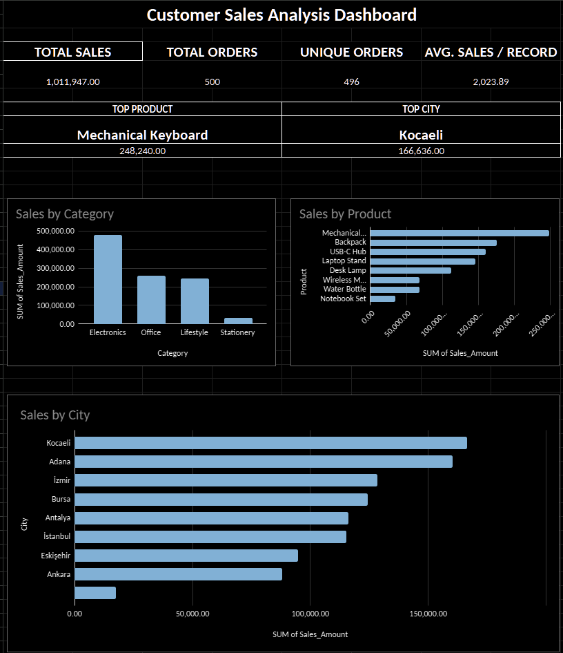

# Customer Sales Analysis Dashboard

### Google Sheets | Data Cleaning | Sales Analysis | Data Visualization

## Project Overview

This project is a hands-on data analysis portfolio exercise built using Google Sheets.

The objective is to organize sales data, calculate key business metrics, and create an interactive-style visual dashboard that makes sales performance easier to understand.

The project demonstrates foundational spreadsheet skills, data organization, pivot table analysis, and business reporting.

## Dataset Overview

The dataset contains 500 sales records with information used to analyze product performance, sales categories, and geographic distribution.

## Key Performance Indicators

| Metric | Result |
|---|---|
| Total Sales | 1,011,947 |
| Total Orders | 500 |
| Unique Orders | 496 |
| Average Sales per Record | 2,023.89 |
| Top Product | Mechanical Keyboard |
| Top Product Sales | 248,240 |
| Top City | Kocaeli |
| Top City Sales | 166,636 |

*All figures are based on the project dataset. Monetary units are not specified.*

## Tools and Techniques

- Google Sheets
- Spreadsheet data cleaning and organization
- Formulas and KPI calculations
- Pivot tables
- Sales aggregation
- Charts and dashboard reporting

## Dashboard Features

The dashboard includes:

- Sales by Product Category
- Sales by Product
- Sales by City
- Summary KPI metrics

These visualizations help identify sales distribution, leading products, and regional performance.

## Workbook Structure

| Worksheet | Purpose |
|---|---|
| Raw_Data | Original dataset |
| Working_Data | Data preparation workspace |
| Clean_Data | Organized data |
| Pivot_Product | Product-level analysis |
| Pivot_Category | Category-level analysis |
| Pivot_Analysis | Additional aggregated analysis |
| KPI_Analysis | Key performance calculations |
| Dashboard | Final visual report |
| Project_Summary | Project overview |

## Key Findings

- Mechanical Keyboard generated the highest product-level sales.
- Kocaeli was the highest-performing city by total sales.
- The dataset contains 500 records and 496 unique orders.
- Product, category, and city-level charts provide different perspectives on overall sales performance.

## Project Purpose

This project was completed as part of my ongoing development in data analysis and spreadsheet-based business reporting.

It is a learning and portfolio project, not a commissioned client assignment.

My goal is to continue improving my skills in data cleaning, reporting, dashboards, and AI-assisted data workflows.
